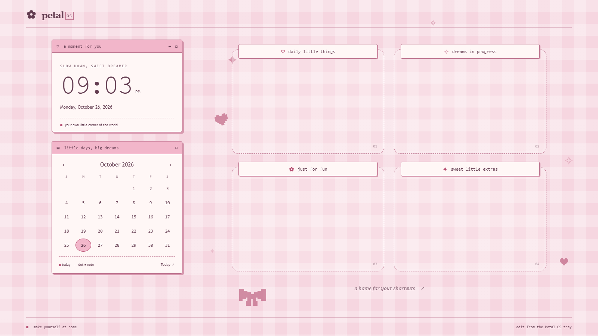

# Petal OS · Our Windows wallpaper app

Petal OS is our own standalone Windows wallpaper app. It includes a native desktop host, an editor, tray controls, and the retro pastel four-panel design. **Lively is not required.**



## Run it

1. [Download Petal-OS-Desktop.zip](https://hkcm91.github.io/retro-girly-wallpaper/downloads/Petal-OS-Desktop.zip).
2. Extract the complete ZIP, keeping its files together.
3. Run **PetalOS.exe**, choose a display, and click **Apply wallpaper**.
4. Use **Personalise** and the calendar in our Desktop Studio editor. Edits appear live on the wallpaper.
5. Close the editor to keep it in the tray. Double-click the tray icon to reopen it. **Stop wallpaper** restores your normal background; **Exit** stops and closes Petal OS.

Windows x64, .NET Framework 4.8 and Edge WebView2 Runtime are required. These were already installed on the test PC. No separate wallpaper app, account, API key or administrator privileges are required. The portable app is unsigned. If needed, get the shared renderer from [Microsoft WebView2](https://developer.microsoft.com/microsoft-edge/webview2/).

## Downloads and preview

- [Windows desktop app](downloads/Petal-OS-Desktop.zip)
- [Complete editable source ZIP](downloads/Petal-OS-Source.zip)
- [Browser-only offline ZIP](downloads/Petal-OS-Offline.zip)
- [Matching Windows icon pack](downloads/Petal-OS-Icons.zip)
- [Checksums](downloads/SHA256SUMS.txt)
- [Browser design preview](https://hkcm91.github.io/retro-girly-wallpaper/?v=3)
- [Full setup guide](https://hkcm91.github.io/retro-girly-wallpaper/README.html)

The Pages site previews the design. A website alone cannot set the Windows desktop wallpaper; our EXE provides that part.

## Features

- Our own Windows wallpaper host, editor, tray menu and display selector.
- Four equal shortcut zones in a 2×2 grid, each with an editable label.
- Live local clock/date and calendar with local notes.
- Pixel decorations, motion control and reduced-motion support.
- Three palettes, accent colors, background styles and custom images.
- Optional editor click sounds, local persistence and export/import.
- Eight original pixel icons in ICO, PNG and SVG.

Settings live in `%LocalAppData%\PetalOS\settings.json`. Browser preview settings are separate; Export / Import transfers them. The extracted app runs locally without internet once its prerequisites are installed.

## Interaction and prototype scope

The wallpaper runs behind Windows icons. For now, interact through our **own editor window**. We do not capture global mouse or keyboard input or hide desktop icons. The panels guide shortcut placement; they are not real folders.

The host uses Explorer's undocumented WorkerW background-window convention. It was verified on a single-display Windows 10 x64 setup with WebView2 155. Windows 11, other desktop customizations, multiple displays, Explorer recovery and sleep/resume need wider testing. If attachment fails, the wallpaper stops and our editor stays available. Automatic startup and fullscreen/battery pause policies are not implemented yet.

## Build

Native source: [`desktop/Program.cs`](desktop/Program.cs).

On Windows with .NET Framework 4.8 and PowerShell:

```powershell
.\desktop\build.ps1 -WebSource $PWD -OutputPath .\build\PetalOS
```

The script uses the Windows Framework compiler and a pinned Microsoft WebView2 SDK package. It checks the local NuGet cache first; otherwise it downloads the package into the source's dependencies folder. The compiled app does not require the SDK or build tools.

The source ZIP includes the web assets, so `build.ps1` can also run with its default arguments. See [`desktop/README.txt`](desktop/README.txt).

## Verification

**Seven real native checks passed:** our EXE and WebView2 loaded the design; the visible wallpaper HWND attached to Explorer's background layer; it fit the screen; editor changes reached the wallpaper; settings saved; Stop removed the wallpaper HWNDs. The test then exited and left the normal desktop in place.

Eleven focused browser/protocol checks passed, covering four panels, label and calendar persistence, native state updates and preventing feedback loops. All ZIPs passed integrity and source-byte checks. See [TEST-RESULTS.txt](TEST-RESULTS.txt).

## License

Our code and original artwork: [MIT](LICENSE.txt). Microsoft's WebView2 binaries use the Microsoft license and notices included in the app's `licenses/` folder.
