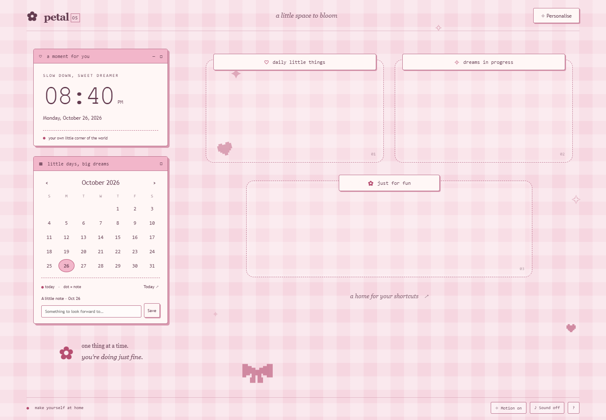

# Petal OS · Retro Girly Wallpaper

A little space to bloom: a self-contained interactive Windows wallpaper for Lively Wallpaper, with a browser preview and original matching pixel icons.

[Open the browser preview](https://hkcm91.github.io/retro-girly-wallpaper/) · [Installation and setup guide](https://hkcm91.github.io/retro-girly-wallpaper/README.html)

## Download

- [Offline package](downloads/Petal-OS-Offline.zip): extract everything and open `index.html` in Edge or Chrome.
- [Lively import package](downloads/Petal-OS-Lively.zip): import the ZIP in Lively, or add `index.html` from a permanent extracted folder.
- [Matching icon pack](downloads/Petal-OS-Icons.zip): eight Windows ICO designs, plus transparent PNGs and editable SVGs.
- [Checksums](downloads/SHA256SUMS.txt)

## Features

- Live local clock and date, with 12/24-hour display.
- Interactive calendar with local date notes, month navigation and Today.
- Animated pixel hearts, sparkles and a bow; motion toggle and reduced-motion support.
- Three editable desktop-zone labels.
- Rose, lavender and mint palettes, custom accent color, four built-in background styles and image upload.
- Optional soft click sounds with volume control; sound is off by default.
- Local settings persistence and JSON export/import, including notes and uploaded image.
- Native Lively Customise controls through `LivelyProperties.json`.

No external fonts, libraries, trackers, accounts, API keys or build tools are required. The extracted package runs without internet. The hosted preview needs internet on first visit; it does not claim a service-worker offline cache.

## Lively input limitations

The zones are visual guides for real Windows shortcuts; the webpage does not manage files or replace Explorer. Windows icons and windows can cover wallpaper controls. Lively enables mouse input by default, but desktop routing and pickers can behave differently from a normal browser.

Use **Library → right-click wallpaper → Customise** for reliable label, color and motion settings. Keyboard input is off by default; enabling it can hide desktop icons. Browser, local-file and Lively storage are independent. Browser changes are not written back to Lively's Customise properties.

See the [official Lively interaction guide](https://github.com/rocksdanister/lively/wiki/Web-Guide-IV-:-Interaction) and the included [full guide](README.html).

## Verification

40 browser assertions passed, including persistence, settings transfer, offline file loading, midnight/year rollover, leap day, responsive layouts and Lively callback handling. ZIP integrity and icon resolutions were checked. Actual Lively import, desktop input routing and audible output still require a check in Lively. Details: [TEST-RESULTS.txt](TEST-RESULTS.txt).

## GitHub Pages

This is a buildless static site. Publish `main` → `/(root)` using **Settings → Pages → Deploy from a branch**. All assets use relative paths and support a project subpath.

## License

[MIT](LICENSE.txt), including the original geometric pixel icon artwork. Lively is a separate product with its own license.
